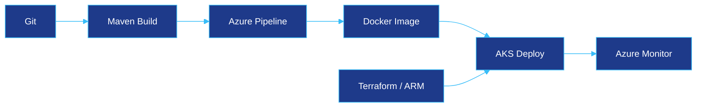

<div align="center">


<a href="https://ravisesham3.github.io">
  
</a>

<br/>


[](https://www.linkedin.com/in/ravindra-babu-sesham-058035304/)
[](https://ravisesham3.github.io)
[](mailto:ravindrasesham4@gmail.com)

</div>


## 👋 About Me

<table>
<tr>
<td width="58%" valign="top">

I'm a **Cloud Engineer** who builds and automates infrastructure on **Microsoft Azure**. I provision environments with **Terraform and ARM Templates**, ship code through **Azure DevOps CI/CD pipelines**, and run containerized apps on **Docker and Kubernetes (AKS)**.

I recently completed a Cloud Engineer internship and I'm preparing for the **AZ-104 Azure Administrator** exam.

☁️ Azure Cloud &nbsp;|&nbsp; 🚀 DevOps &nbsp;|&nbsp; ⚙️ Infrastructure as Code

</td>
<td width="42%" valign="top">

```yaml
name:      Ravindra Babu Sesham
role:      Cloud Engineer | Azure Admin
education: B.Tech CSE · 2022–2026
location:  Darsi, Andhra Pradesh, IN
learning:  AZ-104 · Kubernetes · Terraform
open_to:   Cloud / DevOps Engineer roles
```

</td>
</tr>
</table>

<div align="center">


</div>


## 🛠️ Tech Stack

<div align="center">

**☁️ Cloud &nbsp;•&nbsp; 🚀 DevOps & CI/CD &nbsp;•&nbsp; ⚙️ IaC**


<br/>

**🔧 Scripting & Operating Systems &nbsp;•&nbsp; 🤖 AI/ML & Hardware**


</div>

### ☁️ Azure Services I Work With

| 🖥️ Compute & Data | 🌐 Networking | 🔐 Security | 📊 Monitoring | ⚙️ Automation |
|:---:|:---:|:---:|:---:|:---:|
| Virtual Machines | VNets & Subnets | Key Vault | Azure Monitor | ARM Templates |
| App Service | NSGs | Azure RBAC | Log Analytics | Terraform |
| AKS | Load Balancer | | App Insights | Azure CLI |
| Storage & Blob | | | | DevOps YAML |
| Azure SQL | | | | |


## 🔁 How I Ship




## 💼 Experience

<table>
<tr>
<td width="24%" valign="top">

**Cloud Engineer Intern**

Kloudsavvy Solutions Pvt Ltd

`Jan 2026 – Jun 2026`

</td>
<td width="76%" valign="top">

- ☁️ Worked with Azure VMs, Virtual Networks, Storage Accounts, Azure SQL Database, App Services and Load Balancers
- ⚙️ Automated infrastructure provisioning using ARM Templates and Terraform
- 📊 Worked with Azure Monitor, Log Analytics, Application Insights and Azure Key Vault
- 🔁 Built CI/CD pipelines using Azure DevOps YAML, Azure Repos, Git and Maven
- 🐳 Containerized applications using Docker
- ☸️ Deployed workloads to Azure Kubernetes Service (AKS)
- 🧩 Practiced troubleshooting, deployment automation, branching strategies and Agile collaboration

</td>
</tr>
</table>


## 📌 Featured Projects

<table>
<tr>
<td width="50%" valign="top">

### ☁️ Azure Cloud & DevOps Practice
Azure VMs with VNets, Subnets and NSGs, Storage and Blob, repeatable ARM template deployments, Azure DevOps CI/CD, Git branching and Azure CLI automation.


</td>
<td width="50%" valign="top">

### 🤖 AI Object Detection
Real-time object detection using YOLOv5 and OpenCV.


</td>
</tr>
<tr>
<td width="50%" valign="top">

### 📡 Ultrasonic Radar
Hardware-based obstacle detection and distance measurement using Arduino.


</td>
<td width="50%" valign="top">

### 💬 Telegram AI Bot
NLP-based bot using Hugging Face models.


</td>
</tr>
</table>


## 🎓 Education, Certifications & Learning

<table>
<tr>
<td width="33%" valign="top">

**🎓 Education**

B.Tech, Computer Science & Engineering
Dhanekula Institute of Engineering & Technology
`2022 – 2026`

</td>
<td width="34%" valign="top">

**📜 Certifications**

- 🔄 Azure Administrator (AZ-104): *In Progress*
- ✅ DevOps Foundation Certification
- ✅ Prompt Engineering Certificate

</td>
<td width="33%" valign="top">

**🌱 Currently Learning**

- AZ-104 exam preparation
- Kubernetes deep-dive
- Terraform modules
- End-to-end CI/CD projects

</td>
</tr>
</table>


## 📊 GitHub Activity

<div align="center">


</div>


<div align="center">

## 📫 Let's Connect

I'm open to **Cloud Engineer, Azure and DevOps** opportunities.

[](https://www.linkedin.com/in/ravindra-babu-sesham-058035304/)
[](https://ravisesham3.github.io)
[](mailto:ravindrasesham4@gmail.com)

<br/>

⭐ *"Passionate about cloud infrastructure, DevOps automation, and solving real-world problems."*


</div>
