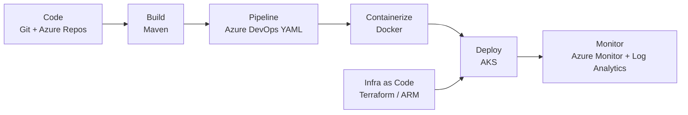

<div align="center">


<a href="https://ravisesham3.github.io">
  
</a>

<br/>


<br/>

[](#about)
[](#skills)
[](#workflow)
[](#experience)
[](#projects)
[](#contact)

</div>


<a id="about"></a>

## 👨‍💻 About Me

<table>
<tr>
<td width="60%" valign="top">

```yaml
name:         Ravindra Babu Sesham
role:         Cloud Engineer | Azure Administrator
focus:        Azure • DevOps • Infrastructure as Code
education:    B.Tech CSE, Dhanekula Institute (2022–2026)
location:     Darsi, Andhra Pradesh, India
learning:     AZ-104 (Azure Administrator)
open_to:      CI/CD pipelines, Azure deployments,
              Kubernetes automation
ask_me_about: Azure, DevOps, Terraform, Docker
```

</td>
<td width="40%" valign="top">

**🎯 What I do**

☁️ Design and deploy Azure infrastructure

⚙️ Automate it with ARM Templates and Terraform

🔁 Ship code through Azure DevOps CI/CD pipelines

☸️ Run containerized workloads on AKS

</td>
</tr>
</table>


<a id="skills"></a>

## 🛠️ Languages & Tools

<div align="center">

### ☁️ Cloud & DevOps


### 🔧 Scripting & Operating Systems


### 🤖 AI / ML & Hardware


</div>

<details>
<summary><b>☁️ Azure services I work with (click to expand)</b></summary>

<br/>

| Compute & Data | Networking | Security & Access | Monitoring | Automation |
|---|---|---|---|---|
| Virtual Machines | VNets & Subnets | Key Vault | Azure Monitor | ARM Templates |
| App Service | NSGs | Azure RBAC | Log Analytics | Terraform |
| AKS | Load Balancer | | Application Insights | Azure CLI |
| Storage Accounts | | | | Azure DevOps YAML |
| Azure SQL | | | | |

</details>


<a id="workflow"></a>

## 🔁 How I Ship




<a id="experience"></a>

## 💼 Experience

<table>
<tr>
<td width="25%" valign="top">

**Jan 2026 – Jun 2026**

Kloudsavvy Solutions Pvt Ltd

</td>
<td width="75%" valign="top">

### Cloud Engineer Intern

- ☁️ Worked with Azure VMs, Virtual Networks, Storage Accounts, Azure SQL Database, App Services and Load Balancers
- ⚙️ Automated infrastructure provisioning using ARM Templates and Terraform
- 📊 Worked with Azure Monitor, Log Analytics, Application Insights and Azure Key Vault
- 🔁 Built CI/CD pipelines using Azure DevOps YAML, Azure Repos, Git and Maven
- 🐳 Containerized applications using Docker
- ☸️ Deployed workloads to Azure Kubernetes Service (AKS)
- 🧩 Practiced troubleshooting, deployment automation, branching strategies and Agile collaboration

</td>
</tr>
</table>


<a id="projects"></a>

## 📌 Featured Projects

<table>
<tr>
<td width="50%" valign="top">

### ☁️ Azure Cloud & DevOps Practice
VMs with VNets, Subnets and NSGs, Storage and Blob, ARM templates, Azure DevOps CI/CD, Git branching and Azure CLI automation.

`Azure` `ARM` `Azure DevOps` `Git`

</td>
<td width="50%" valign="top">

### 🤖 AI Object Detection
Real-time object detection using YOLOv5 and OpenCV.

`YOLOv5` `OpenCV` `Python`

</td>
</tr>
<tr>
<td width="50%" valign="top">

### 📡 Ultrasonic Radar
Hardware-based obstacle detection and distance measurement using Arduino.

`Arduino` `Sensors`

</td>
<td width="50%" valign="top">

### 💬 Telegram AI Bot
NLP-based bot using Hugging Face models.

`Hugging Face` `Python` `NLP`

</td>
</tr>
</table>


## 🎓 Education & Certifications

<table>
<tr>
<td width="50%" valign="top">

**🎓 Education**

B.Tech, Computer Science & Engineering
Dhanekula Institute of Engineering & Technology
2022 – 2026

</td>
<td width="50%" valign="top">

**📜 Certifications**

- 🔄 Azure Administrator (AZ-104): *In Progress*
- ✅ DevOps Foundation Certification
- ✅ Prompt Engineering Certificate

</td>
</tr>
</table>


## 📊 GitHub Streak

<div align="center">


</div>

<!--
OPTIONAL: uncomment after adding .github/workflows/snake.yml and running it once from the Actions tab.

<div align="center">

</div>
-->


<a id="contact"></a>

## 📫 Let's Connect

<div align="center">

[](https://www.linkedin.com/in/ravindra-babu-sesham-058035304/)
[](https://ravisesham3.github.io)
[](mailto:ravindrasesham4@gmail.com)

<br/>

⭐ *"Passionate about cloud infrastructure, DevOps automation, and solving real-world problems."*


</div>
