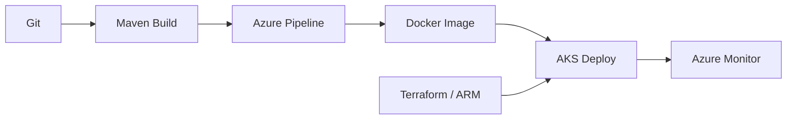

<div align="center">


<a href="https://ravisesham3.github.io">
  
</a>

<br/>


<br/>

[](https://www.linkedin.com/in/ravindra-babu-sesham-058035304/)
[](https://ravisesham3.github.io)
[](mailto:ravindrasesham4@gmail.com)

</div>


## 👋 Hi, I'm Ravindra

I'm a **Cloud Engineer** who builds and automates infrastructure on **Microsoft Azure**. I provision environments with **Terraform and ARM Templates**, ship code through **Azure DevOps CI/CD pipelines**, and run containerized apps on **Docker and Kubernetes (AKS)**. I recently completed a Cloud Engineer internship and I'm preparing for the **AZ-104 Azure Administrator** exam.

<table>
<tr>
<td width="55%" valign="top">

```yaml
name:         Ravindra Babu Sesham
role:         Cloud Engineer | Azure Administrator
focus:        Azure • DevOps • Infrastructure as Code
education:    B.Tech CSE, Dhanekula Institute (2022–2026)
location:     Darsi, Andhra Pradesh, India
learning:     AZ-104, Kubernetes, Terraform
open_to:      Cloud / DevOps Engineer roles
ask_me_about: Azure, DevOps, Terraform, Docker
```

</td>
<td width="45%" valign="top">

### 🎯 What I do

☁️ Design and deploy Azure infrastructure

⚙️ Automate it with Terraform and ARM

🔁 Build CI/CD pipelines in Azure DevOps

🐳 Containerize apps with Docker

☸️ Deploy and run workloads on AKS

📊 Monitor with Azure Monitor and Log Analytics

</td>
</tr>
</table>


## 🛠️ Tech Stack

<div align="center">

### ☁️ Cloud


### 🚀 DevOps & CI/CD


### ⚙️ Infrastructure as Code


### 🔧 Scripting & Operating Systems


### 🤖 AI / ML & Hardware


</div>

### ☁️ Azure Services I Work With

| 🖥️ Compute & Data | 🌐 Networking | 🔐 Security & Access | 📊 Monitoring | ⚙️ Automation |
|---|---|---|---|---|
| Virtual Machines | VNets & Subnets | Key Vault | Azure Monitor | ARM Templates |
| App Service | NSGs | Azure RBAC | Log Analytics | Terraform |
| AKS | Load Balancer | | Application Insights | Azure CLI |
| Storage & Blob | | | | Azure DevOps YAML |
| Azure SQL | | | | |


## 🔁 How I Ship




## 💼 Experience

<table>
<tr>
<td width="25%" valign="top">

**Jan 2026 – Jun 2026**

Kloudsavvy Solutions Pvt Ltd

</td>
<td width="75%" valign="top">

### Cloud Engineer Intern

- ☁️ Worked with Azure VMs, Virtual Networks, Storage Accounts, Azure SQL Database, App Services and Load Balancers
- ⚙️ Automated infrastructure provisioning using ARM Templates and Terraform
- 📊 Worked with Azure Monitor, Log Analytics, Application Insights and Azure Key Vault
- 🔁 Built CI/CD pipelines using Azure DevOps YAML, Azure Repos, Git and Maven
- 🐳 Containerized applications using Docker
- ☸️ Deployed workloads to Azure Kubernetes Service (AKS)
- 🧩 Practiced troubleshooting, deployment automation, branching strategies and Agile collaboration

</td>
</tr>
</table>


## 📌 Featured Projects

<table>
<tr>
<td width="50%" valign="top">

### ☁️ Azure Cloud & DevOps Practice
Azure VMs with VNets, Subnets and NSGs, Storage and Blob, repeatable ARM template deployments, Azure DevOps CI/CD, Git branching and Azure CLI automation.


</td>
<td width="50%" valign="top">

### 🤖 AI Object Detection
Real-time object detection using YOLOv5 and OpenCV.


</td>
</tr>
<tr>
<td width="50%" valign="top">

### 📡 Ultrasonic Radar
Hardware-based obstacle detection and distance measurement using Arduino.


</td>
<td width="50%" valign="top">

### 💬 Telegram AI Bot
NLP-based bot using Hugging Face models.


</td>
</tr>
</table>


## 🎓 Education & Certifications

<table>
<tr>
<td width="50%" valign="top">

### 🎓 Education

**B.Tech, Computer Science & Engineering**
Dhanekula Institute of Engineering & Technology
2022 – 2026

</td>
<td width="50%" valign="top">

### 📜 Certifications


</td>
</tr>
</table>


## 🌱 Currently Learning & Goals

- 🎯 Passing **AZ-104 – Microsoft Azure Administrator**
- ☸️ Going deeper into **Kubernetes** and **Terraform** modules
- 🔁 Building more end-to-end **CI/CD** projects and publishing them here


## 📊 GitHub Activity

<div align="center">


</div>

<!--
OPTIONAL: uncomment after adding .github/workflows/snake.yml and running it once from the Actions tab.

<div align="center">

</div>
-->


## 📫 Let's Connect

<div align="center">

I'm open to **Cloud Engineer, Azure and DevOps** opportunities. Feel free to reach out.

[](https://www.linkedin.com/in/ravindra-babu-sesham-058035304/)
[](https://ravisesham3.github.io)
[](mailto:ravindrasesham4@gmail.com)

<br/>

⭐ *"Passionate about cloud infrastructure, DevOps automation, and solving real-world problems."*


</div>
